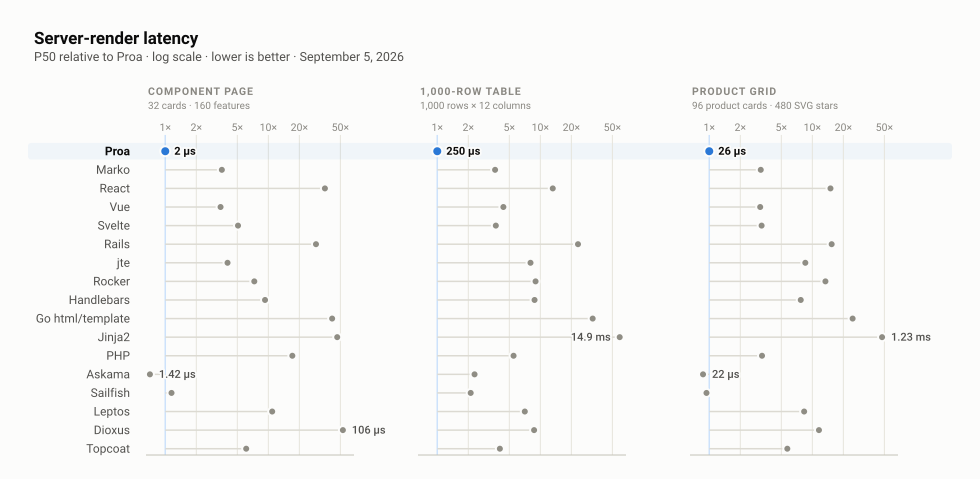
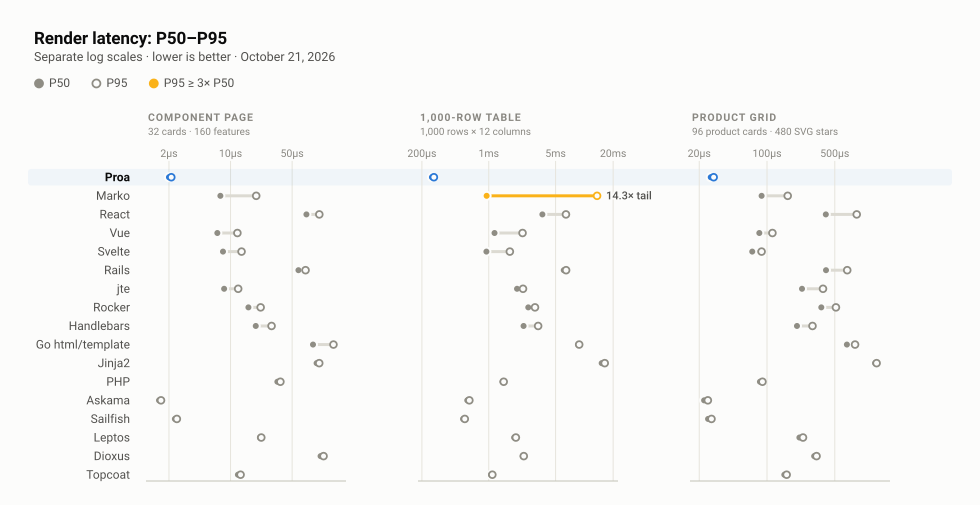

# Proa benchmarks

[Proa](https://github.com/Proa-Labs/proa) renders typed Rust components to HTML on the server, streams them, and hydrates fine-grained browser islands. This page shows what one core [serves over HTTP](#serving-three-pages-on-one-core), how fast [seventeen renderers](#rendering-the-same-pages-in-seventeen-renderers) render those pages, [why the numbers hold](#why-trust-these-numbers), and [how to reproduce them](#reproducing-a-capture).

**Who runs these benchmarks.** Proa Labs builds Proa and ran every capture here, which is a conflict of interest. The harness is therefore written to be checked rather than believed: every adapter, gate, and raw artifact is in this repo, the rules are fixed before anything is timed, and results that go against Proa stay on the page. If you find a way the comparison is unfair, open an issue — that is the most useful contribution this repo can get.

<!-- Keep this HTML table free of blank lines so GitHub renders it as one block. -->
<table>
  <tr>
    <td valign="top" width="50%">
      <h3 id="serving-three-pages-on-one-core">Serving three pages on one core</h3>
      <p>Three canonical pages, one core each: throughput at saturation, latency at a fixed request rate.</p>
      <!-- charts:headline:start -->
      <a href="charts/svg/08-canonical-pages-http.svg">
        
      </a>
      <p><em>Three parity-gated pages on loopback HTTP, one core per engine. <a href="http-capacity.md#canonical-pages-over-http-one-core-each">Details</a> · <a href="charts/svg/08-canonical-pages-http.svg">Full size</a> · <a href="charts/">how the figures are built</a></em></p>
      <!-- charts:headline:end -->
    </td>
    <td valign="top" width="50%">
      <h3 id="suspense-streaming-over-http-one-core-each">Streaming the product grid through Suspense</h3>
      <p>Single-core Suspense streaming with eight async boundaries per request.</p>
      <!-- charts:suspense:start -->
      <a href="charts/svg/07-suspense-load.svg">
        
      </a>
      <p><em>Throughput sweep with queueing markers (P50/P95/P99 + memory) at each rate. <a href="http-capacity.md#suspense-streaming-over-http-one-core-each">Details</a> · <a href="charts/svg/07-suspense-load.svg">Full size</a> · <a href="charts/">how the figures are built</a></em></p>
      <!-- charts:suspense:end -->
    </td>
  </tr>
  <tr>
    <td valign="top" width="50%">
      <h3 id="cold-start-to-first-response">Cold start to first response</h3>
      <p>Startup latency from process creation to first byte-identical response.</p>
      <!-- charts:coldstart:start -->
      <a href="charts/svg/09-cold-start.svg">
        
      </a>
      <p><em>Median, P95, and worst-start across 15 fresh processes. <a href="http-capacity.md#cold-start-to-first-response">Details</a> · <a href="charts/svg/09-cold-start.svg">Full size</a> · <a href="charts/">how the figures are built</a></em></p>
      <!-- charts:coldstart:end -->
    </td>
    <td valign="top" width="50%">
      <h3 id="rendering-the-same-pages-in-seventeen-renderers">Rendering the same pages in seventeen renderers</h3>
      <p>Renderer-only benchmark across three canonical pages: component, table, and product grid.</p>
      <!-- charts:scoreboard:start -->
      <a href="charts/svg/01-canonical-scoreboard.svg">
        
      </a>
      <p><em>Seventeen renderers, one-core P50 multiples on log scale. <a href="scoreboard.md">Details</a> · <a href="charts/svg/01-canonical-scoreboard.svg">Full size</a> · <a href="charts/">how the figures are built</a></em></p>
      <!-- charts:scoreboard:end -->
    </td>
  </tr>
  <tr>
    <td valign="top" width="50%">
      <h3 id="canonical-tails-on-one-core">Canonical latency tails on one core</h3>
      <p>Single-core P50 and P95 for the same three canonical workloads.</p>
      <!-- charts:canonical-tail-dispersion:start -->
      <a href="charts/svg/02-canonical-tail-dispersion.svg">
        
      </a>
      <p><em>Tail spread with heavy-tail markers on three workloads. <a href="scoreboard.md#detailed-measurements">Details</a> · <a href="charts/svg/02-canonical-tail-dispersion.svg">Full size</a> · <a href="charts/">how the figures are built</a></em></p>
      <!-- charts:canonical-tail-dispersion:end -->
    </td>
    <td valign="top" width="50%">
      <h3 id="render-time-vs-memcpy-on-one-core">Render time vs memcpy on one core</h3>
      <p>Legacy one-core mechanism view: workload speed vs Proa memcpy floor.</p>
      <!-- charts:representative-core-matrix:start -->
      <a href="charts/svg/03-representative-matrix.svg">
        
      </a>
      <p><em>Three workloads + allocation context as multiples of a memcpy baseline. <a href="engineering.md#showcase-memcpy-floor">Details</a> · <a href="charts/svg/03-representative-matrix.svg">Full size</a> · <a href="charts/">how the figures are built</a></em></p>
      <!-- charts:representative-core-matrix:end -->
    </td>
  </tr>
  <tr>
    <td valign="top" width="50%">
      <h3 id="proa-linked-showcase-corpus">Proa linked showcase corpus</h3>
      <p>Proa-only linked pages: five runs each, with render range and size.</p>
      <!-- charts:showcase-corpus:start -->
      <a href="charts/svg/06-showcase-corpus.svg">
        
      </a>
      <p><em>Application-like page samples and stability notes. <a href="engineering.md#linked-proa_showcase-corpus">Details</a> · <a href="charts/svg/06-showcase-corpus.svg">Full size</a> · <a href="charts/">how the figures are built</a></em></p>
      <!-- charts:showcase-corpus:end -->
    </td>
    <td valign="top" width="50%"></td>
  </tr>
</table>

The capacity of a core follows from the render itself, which the <a href="#rendering-the-same-pages-in-seventeen-renderers">scoreboard</a> isolates. Every cell in that figure passed the same gate, described in <a href="#why-trust-these-numbers">Why trust these numbers</a>.

## Why trust these numbers?

- **Parity comes first.** Chromium parses each renderer's untimed output, and the harness compares elements, attributes, classes, visible text, and body order against Proa's. A negative control mutates the output and asserts that the gate rejects it. If any cell fails, the harness times nothing.
- **Every engine gets one core.** CPU per response counts every thread of the server process, including garbage-collector helpers. Where a framework still uses more than one core, the cores column says so.
- **The load generator checks itself.** Several worker processes check every response: the page captures hash it against the parity-gated dump, and the streaming capture validates the shell, every panel, and every product card. The capture rejects a phase if any worker's event loop exceeds 80% busy or arrivals lag more than 25 ms at P95. A saturated client therefore cannot pose as a saturated server.
- **Fresh processes, rotated order, medians.** Every value is the median of independent process runs. Renderer order rotates between runs, and the harness discards no sample once it knows the labels.
- **Contrary results stay.** Askama and Sailfish beating Proa, Marko's smaller payloads, and the narrow streaming margin carry the same weight as the wins.
- **Some costs sit outside every measurement.** Every capture excludes databases, routing, middleware, network latency, hydration, and compression. The scoreboard also excludes HTTP. The HTTP captures include parsing, serialization, allocation, and each server's write path.

> **Good to know**: every rendering and HTTP capture on this page ran on one Apple M4 Max under macOS, building Proa from `main` at the revision the lockfile pins. The separate browser-agent control ran on a Linux VPS instead, and [`travel-agent/`](travel-agent/) records that host. Absolute numbers differ on Linux server hardware. The harness runs there unchanged, and each artifact records host, OS, commit, and a source fingerprint.

Each capture is one command, described in [Reproducing a capture](#reproducing-a-capture).

## Reproducing a capture

Install the JavaScript dependencies once. You need Node.js 24.20.0 exactly — the canonical runner compares `process.version` and refuses to run on anything else — with pnpm, the Rust toolchain in [`rust-toolchain.toml`](rust-toolchain.toml), and Go 1.25. The full scoreboard also needs Ruby 3.2+, a JDK 17+ with Gradle, PHP 8, and Python 3.13+.

```sh filename="Terminal"
pnpm install --frozen-lockfile
pnpm exec playwright install chromium
npm ci --prefix rendering/external/react
npm ci --prefix rendering/external/marko
npm ci --prefix rendering/external/handlebars
```

Then run a suite. Each command builds its servers, gates every page for parity, and rewrites its evidence page. It refuses to publish a phase whose load generator was the bottleneck.

```sh filename="Terminal"
./rendering/run-all            # scoreboard: build, parity-gate, time, regenerate scoreboard.md
pnpm run bench:page-load       # canonical pages over HTTP, one core each
pnpm run bench:cold-start      # cold start to first response
pnpm run bench:suspense-load   # Suspense streaming over HTTP
pnpm run refresh               # regenerate every evidence page and figure from the captures
```

> **Good to know**: the committed numbers are dated evidence from one machine, not universal claims. Rerun the relevant suite before publishing a current comparison.

## Next steps

- [HTTP capacity, cold start and streaming](http-capacity.md)
  - Sustained responses per second, CPU per response, latency at equal load, and cold start for four production servers.
- [Canonical scoreboard evidence](scoreboard.md)
  - The seventeen-renderer table, parity coverage, every retained percentile, and the adapters side by side.
- [Engineering, application and agent captures](engineering.md)
  - Product-grid scaling, the memcpy floor, Proa's buffer allocation, client JavaScript, and the archived August report.
- [Benchmark figures](charts/)
  - How every SVG is drawn from the evidence pages' own tables and checked against them.
- [Canonical benchmark protocol](rendering/protocol.md)
  - The fairness rules, workload shapes, and parity gate in full.
- Suite READMEs: [`rendering/`](rendering/), [`page-load/`](page-load/), [`suspense-load/`](suspense-load/), [`load/`](load/), [`showcase/`](showcase/), [`agent-chain/`](agent-chain/), and the separate [`travel-agent/`](travel-agent/) control.

## License and attribution

This repository is Apache-2.0; see [`LICENSE`](LICENSE). Benchmark adapters incorporate upstream work under its own terms, recorded in [`rendering/UPSTREAM_LICENSES.md`](rendering/UPSTREAM_LICENSES.md).

React, Marko, Vue, Svelte, Rails, jte, Rocker, Handlebars, Go, Jinja2, PHP, Askama, Sailfish, Leptos, Dioxus, and Topcoat belong to their respective owners. They appear here as the subjects of a benchmark; their inclusion implies no endorsement.
