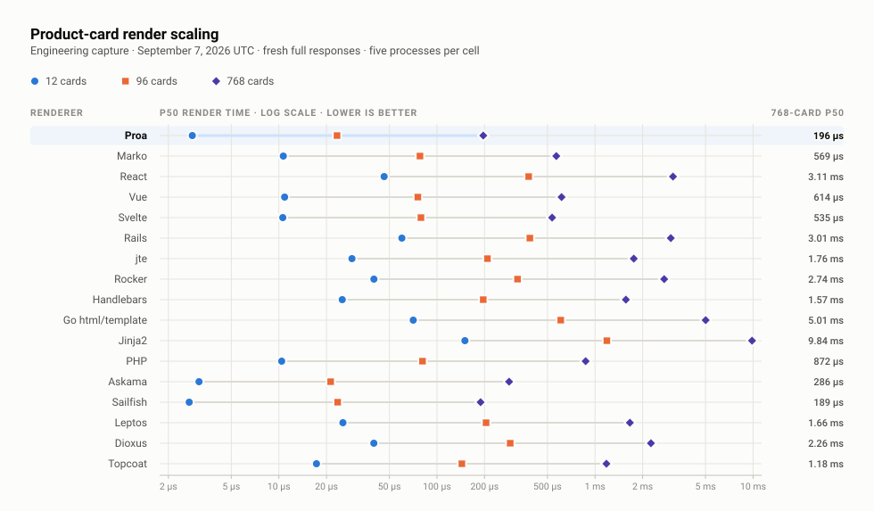
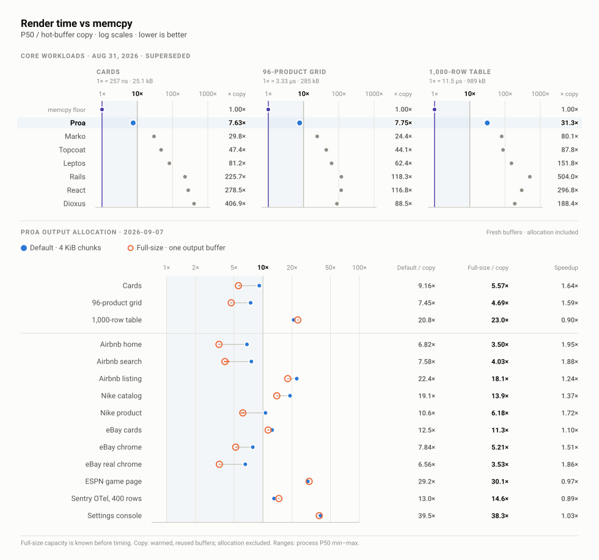
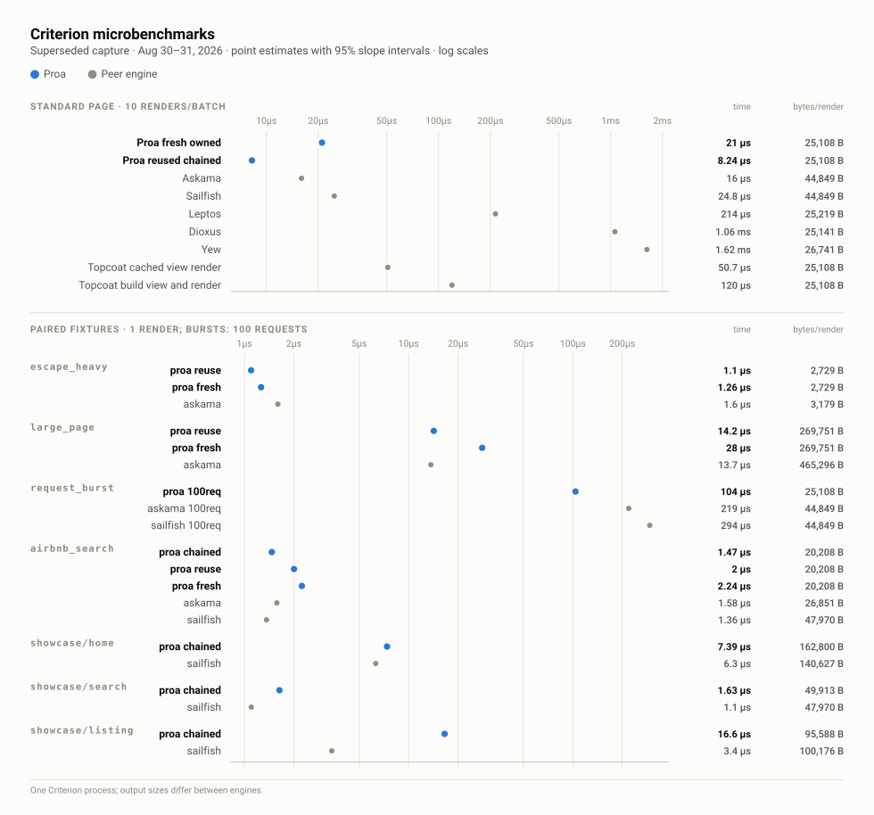
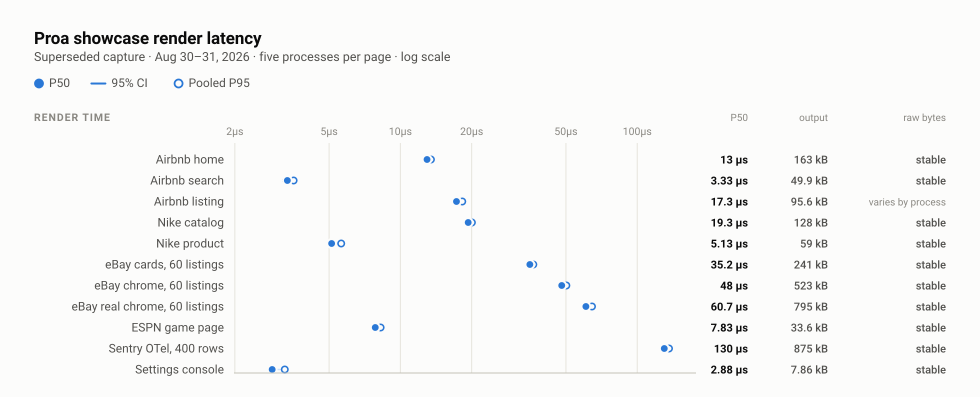

# Engineering and application captures

These captures answer narrower questions than the scoreboard, and each states its own measurement boundary. This page holds [product-grid scaling](#product-grid-scaling-capture), the [showcase memcpy floor](#showcase-memcpy-floor), [Proa's output-buffer allocation](#proa-output-buffer-allocation), the [client JavaScript reference](#client-javascript-reference), and the [archived August 30–31 report](#archived-results-august-3031-2026).

<!-- product-scaling:start -->
## Product-grid scaling capture

This September 7, 2026 UTC engineering capture repeats the canonical product-grid
contract at 12, 96, and 768 cards. Every value includes component/template
execution and a fresh independently owned response; deterministic input
construction remains outside timing. All 51 renderer/size cells passed the same
semantic-DOM parity gate used by the canonical scoreboard. Each cell below is
the median of 5 independent process P50s, using 2000, 500, and 100 measured
renders per process respectively.

| Renderer | 12 cards P50 | 96 cards P50 | 768 cards P50 |
| --- | ---: | ---: | ---: |
| Proa | 2.834 µs | 23.333 µs | 196.271 µs |
| Marko | 10.666 µs | 78.063 µs | 568.750 µs |
| React | 46.334 µs | 380.312 µs | 3.112 ms |
| Vue | 10.875 µs | 75.708 µs | 613.938 µs |
| Svelte | 10.583 µs | 79.208 µs | 535.021 µs |
| Rails | 60.000 µs | 387.000 µs | 3.014 ms |
| jte | 29.000 µs | 208.563 µs | 1.758 ms |
| Rocker | 39.916 µs | 323.334 µs | 2.737 ms |
| Handlebars | 25.166 µs | 196.187 µs | 1.567 ms |
| Go html/template | 70.792 µs | 606.833 µs | 5.008 ms |
| Jinja2 | 150.291 µs | 1.188 ms | 9.842 ms |
| PHP | 10.417 µs | 81.020 µs | 871.875 µs |
| Askama | 3.125 µs | 21.250 µs | 285.875 µs |
| Sailfish | 2.709 µs | 23.542 µs | 188.771 µs |
| Leptos | 25.417 µs | 204.500 µs | 1.661 ms |
| Dioxus | 39.875 µs | 290.625 µs | 2.257 ms |
| Topcoat | 17.292 µs | 143.750 µs | 1.180 ms |

The 96-card column is an independent engineering capture, not a replacement
for the canonical result. Reproduce the matrix with
`./rendering/run-all --product-scaling`; the retained summary and per-process
measurements are in [`rendering/results/product-scaling.json`](rendering/results/product-scaling.json)
and [its raw process artifact](rendering/results/raw/product-scaling-v1-2026-09-07-3e9dba799481/process-summaries.json).
<!-- product-scaling:end -->

[](charts/svg/05-product-card-scaling.svg)

*The canonical roster on one boundary: prepared data in, fresh independently owned HTML out. All 51 renderer/size cells passed semantic-DOM parity. Drawn from the [product-grid scaling capture](#product-grid-scaling-capture) · [Full size](charts/svg/05-product-card-scaling.svg) · [how the figures are built](charts/)*

The next two captures ask how close Proa's render sits to the cost of copying its own output, starting with the [showcase memcpy floor](#showcase-memcpy-floor).

<!-- showcase-memcpy:start -->
## Showcase memcpy floor

| Memcpy capture | Date (UTC) | Proa revision |
| --- | --- | --- |
| All 12 linked pages | September 7, 2026 | `9f8a8fa9bde1` |

Complete Proa page rendering against a hot-buffer copy of that page's exact
pre-rendered HTML. Each cell is the median of five process P50s; brackets show
their min–max range. Rendering includes page construction and fresh output
allocation. Copying reuses warmed source and destination buffers and excludes
allocation. All linked pages are included: **4 of 12 are within 10×** in this capture.

| Showcase page | Output bytes | Proa P50 µs [min–max] | Memcpy P50 µs [min–max] | Proa / memcpy |
| --- | ---: | ---: | ---: | ---: |
| Airbnb parity | 149,339 | 165.792 [164.291–166.750] | 1.415 [1.413–1.420] | 117.15× |
| Airbnb home | 162,800 | 12.958 [12.834–13.000] | 1.917 [1.862–1.919] | 6.76× |
| Airbnb search | 49,913 | 3.375 [3.292–3.417] | 0.469 [0.411–0.476] | 7.20× |
| Airbnb listing | 95,588 | 17.167 [17.125–17.209] | 0.777 [0.762–0.778] | 22.09× |
| Nike catalog | 128,211 | 19.292 [19.042–19.459] | 1.031 [1.029–1.032] | 18.71× |
| Nike product | 58,959 | 5.083 [4.958–5.166] | 0.505 [0.489–0.553] | 10.07× |
| eBay cards | 240,785 | 35.083 [34.875–35.333] | 2.819 [2.807–2.820] | 12.45× |
| eBay chrome | 522,876 | 47.666 [47.333–48.000] | 6.092 [6.086–6.092] | 7.82× |
| eBay real chrome | 794,776 | 60.916 [60.041–61.083] | 9.239 [9.239–9.241] | 6.59× |
| ESPN game page | 33,618 | 7.875 [7.833–8.000] | 0.275 [0.273–0.278] | 28.62× |
| Sentry OTel, 400 rows | 875,334 | 131.500 [129.250–132.709] | 10.173 [10.171–10.175] | 12.93× |
| Settings console | 7,860 | 2.917 [2.834–2.917] | 0.073 [0.072–0.080] | 39.78× |

Render and copy cells run in seeded randomized blocks, one fresh process per
page and mode in each of five repeats. Rendering uses 1,000 warmups and 10,000
samples (Sentry: 100 and 300); copying uses 200 warmup batches and 2,000 measured
batches of at least 16 MiB, divided by copies per batch. Byte counts and canonical
document hashes must agree across every process and both modes.

These are Proa-only application fixtures; no equivalent React capture is available
here. They are separate from the dated core matrix and canonical scoreboard.
The [retained capture](showcase/results/memcpy-floor.json) includes per-process
measurements, source hashes, host details and the linked binary SHA-256.
See [reproduction instructions](showcase/README.md#memcpy-floor).
<!-- showcase-memcpy:end -->

<!-- proa-buffers:start -->
## Proa output-buffer allocation

| Buffer capture | Date (UTC) | Proa revision |
| --- | --- | --- |
| 14 workloads · five processes per cell | 2026-09-07 | `9f8a8fa9bde1` |

Standard Proa uses its 4 KiB chained writer. The full-size variant allocates a
fresh contiguous output buffer for every render, with capacity set to the final
HTML byte count measured before timing. Allocation, page construction and
runtime-tag insertion are timed; response destruction is outside both timings.
Memcpy copies the same HTML into a warmed reusable buffer with allocation excluded.

| Buffer comparison workload | Output bytes | Default P50 µs [min–max] | Full-size P50 µs [min–max] | Copy P50 µs [min–max] | Default / copy | Full-size / copy | Speedup |
| --- | ---: | ---: | ---: | ---: | ---: | ---: | ---: |
| Cards | 25,108 | 1.917 [1.917–1.959] | 1.167 [1.167–1.208] | 0.209 [0.205–0.303] | 9.16× | 5.57× | 1.64× |
| 96-product grid | 284,908 | 24.834 [24.708–25.084] | 15.625 [15.417–15.750] | 3.332 [3.331–3.333] | 7.45× | 4.69× | 1.59× |
| 1,000-row table | 988,509 | 238.875 [237.250–240.959] | 263.958 [261.834–268.292] | 11.488 [11.485–11.488] | 20.79× | 22.98× | 0.90× |
| Airbnb home | 162,800 | 13.083 [12.917–13.125] | 6.709 [6.667–6.833] | 1.919 [1.918–1.920] | 6.82× | 3.50× | 1.95× |
| Airbnb search | 49,913 | 3.375 [3.334–3.416] | 1.792 [1.750–2.000] | 0.445 [0.409–0.483] | 7.58× | 4.03× | 1.88× |
| Airbnb listing | 95,588 | 17.208 [17.084–17.292] | 13.875 [13.792–14.125] | 0.768 [0.766–0.771] | 22.40× | 18.06× | 1.24× |
| Nike catalog | 128,211 | 19.584 [19.417–19.667] | 14.292 [14.167–14.542] | 1.026 [1.025–1.034] | 19.08× | 13.92× | 1.37× |
| Nike product | 58,959 | 5.083 [5.000–5.083] | 2.958 [2.833–3.084] | 0.479 [0.477–0.686] | 10.62× | 6.18× | 1.72× |
| eBay cards | 240,785 | 35.125 [34.959–35.167] | 31.875 [31.500–32.917] | 2.819 [2.818–2.824] | 12.46× | 11.31× | 1.10× |
| eBay chrome | 522,876 | 47.791 [47.667–48.500] | 31.750 [31.667–32.792] | 6.093 [6.092–6.095] | 7.84× | 5.21× | 1.51× |
| eBay real chrome | 794,776 | 60.584 [60.458–60.792] | 32.584 [32.417–33.292] | 9.242 [9.241–9.242] | 6.56× | 3.53× | 1.86× |
| ESPN game page | 33,618 | 8.042 [7.917–8.167] | 8.292 [8.125–8.375] | 0.275 [0.275–0.276] | 29.20× | 30.11× | 0.97× |
| Sentry OTel, 400 rows | 875,334 | 132.375 [131.584–136.625] | 148.750 [146.916–150.500] | 10.175 [10.175–10.175] | 13.01× | 14.62× | 0.89× |
| Settings console | 7,860 | 2.917 [2.833–3.000] | 2.833 [2.708–2.833] | 0.074 [0.072–0.079] | 39.47× | 38.33× | 1.03× |

Cells run in seeded randomized blocks, with five fresh processes per workload
and mode. Values are medians of process P50s; ranges show their min–max.
Every process verifies equal output bytes and canonical HTML, and the full-size
buffer must keep its original capacity through every measured render.
The exact-size hint is an experimental input, not knowledge available to every
production request. The comparison changes the output writer as well as its
allocation strategy. See the [retained capture](showcase/results/buffer-comparison.json)
and [reproduction instructions](showcase/README.md#output-buffer-comparison).
<!-- proa-buffers:end -->

[](charts/svg/03-representative-matrix.svg)

*Memcpy multiples and Proa's full-size allocation comparison. Sources: the [dated core matrix](#representative-core-matrix-seven-renderers-plus-a-memcpy-floor) and the [matched Proa allocation measurements](#proa-output-buffer-allocation) · [Full size](charts/svg/03-representative-matrix.svg) · [how the figures are built](charts/)*

[](charts/svg/04-criterion-microbenchmarks.svg)

*Criterion rows that had a non-Proa peer on the same fixture, with each row's response size beside it. Several of these pairings are deliberately not byte-parity comparisons. Drawn from the [representative core matrix](#representative-core-matrix-seven-renderers-plus-a-memcpy-floor) · [Full size](charts/svg/04-criterion-microbenchmarks.svg) · [how the figures are built](charts/)*

## Client JavaScript reference

This repository's agent-chain fixture uses React 19, `hydrateRoot`, and an interactive form workflow. The row below measures its production minified ESM bundle with the benchmark's synthetic 64 KiB transfer padding excluded. It implements different behavior from the Proa showcase pages, so these measurements do not support a framework payload comparison.

| Client reference | JS requests | Raw bytes | Gzip-9 bytes | Brotli-11 bytes |
| --- | ---: | ---: | ---: | ---: |
| React 19 SSR hydration fixture | 1 | 195,379 | 60,911 | 52,455 |

Recompute it with `pnpm run bench:react-hydration-payload`.

[](charts/svg/06-showcase-corpus.svg)

*Eleven pages from the [linked showcase corpus](#linked-proa_showcase-corpus) · [Full size](charts/svg/06-showcase-corpus.svg) · [how the figures are built](charts/)*

The [Agent workflows](#agent-workflows) section uses published travel tasks extended through reservation review to evaluate the opportunity for an optimized Proa flow.

## Archived results, August 30–31, 2026

These tables keep their original fixtures and measurement boundaries. Their section labels and caveats define what to compare, and they are not current rankings.

<details>
<summary>Archived engineering, application, browser, and agent tables (long)</summary>

<!-- historical-results:start -->
> **Historical and engineering evidence.** The tables below retain their original fixtures and measurement boundaries. Do not compare them with the current canonical scoreboard unless a section explicitly says it uses the same contract. The superseded seven-renderer matrix and the non-parity-gated cross-language loop are preserved as dated evidence, not current rankings.

### Raw results — August 30–31, 2026

These are the direct harness numbers from one local run. They have not been
normalized across workloads or converted into cross-framework ratios.

| Provenance | Value |
| --- | --- |
| Host | Apple M4 Max, 16 logical CPUs, 128 GiB RAM |
| OS | macOS 26.5.2 (25F84), arm64 |
| Merged `main` base | `f757a705d04500628b85c48f895cf829a04c0c8a` |
| Result branch | `bench/raw-results-2026-08-30` |
| Capture HEAD | `2aed63d293c27aee7ebcaffcf37376deacb11912` (dirty input digests are retained in the reports) |
| Representative-matrix recapture | `perf/proa-construction-paths` at harness commit `4aee836970dfefad9601b1eef89866f0405120d5`; captured `2026-08-31T19:52:49.022Z` from merged `main` `ac5b5d3e501d73d0f0d75e33423f263cc3016069` |
| Locked benchmark Proa revision | `85d7a6b2550f288936c0a9c05fe1f2a967f6b013` |
| Local `/Users/andrewhariri/Desktop/proa` HEAD at review | `b5a5fdeea69bbeccb737c751a9b6f9c8e42c3884`; `proa_showcase` tree `34db95469ed328de6534f2925d0bcb9e9e776208` is identical to the locked revision |
| Root `Cargo.lock` SHA-256 | `2d453521c647bdcd2e49c9d1095a0b577b1d5447d64460e8e2b46a12f02eda8a` |
| Showcase fixture `Cargo.lock` SHA-256 | `c71ec0c163512c9f6572f4b3e506ea3f1f7466fbbba153168ded4fdb29570f7c` |
| Linked showcase binary SHA-256 | `eeaa3e760e46fa356ffc1acaf9c404f08de55a935e05e9b67ac3825f9e7cbdc4` (10,749,936 bytes) |
| Rust | 1.95.0 |
| Node / Playwright / Chromium | 23.2.0 / 1.61.1 / 149.0.7827.55 |
| Browser Use / system Chrome | 0.13.8 / 152.0.7977.65 |

#### Rendering

##### Representative core matrix: seven renderers plus a memcpy floor

> **Superseded capture.** This matrix predates the current 17-renderer run above. It remains here for process-to-process history and the memcpy control; do not use it as the current scoreboard.

This is the cross-framework table to use when a consistent roster matters. All
seven implementations render the same three fixed workloads with data creation
outside the timed path:

- `cards`: 4 sections, 32 cards, 160 feature-list items;
- `table`: 1,000 rows and 12 columns with escaping, numeric/date formatting,
  status branches, and variable-length tag lists;
- `products`: 96 component-shaped product cards and 480 SVG stars.

The Proa table uses `text!` for dynamic text and standard numeric padding.
Currency grouping is the one small `Display` helper because Rust formatting
does not provide a thousands-separator specifier; it is streamed through
`text!` without an intermediate `String`. The fixture contains no manual
`WriteBuf` or spare-capacity formatting path.

All 21 renderer/workload cells passed the browser-DOM parity gate. The gate
requires identical elements, attributes, class sets, visible text, and body
order. It ignores renderer-internal comments, React's timed and retained
resource-preload hint, non-semantic `<head>` order, and class-token order.
Output byte counts remain visible because renderer comments, hints, and authored
whitespace still consume serialization work and response bytes. The three
memcpy rows are timing controls, not renderers, so they do not add parity cells.

Each number below is based on five independent processes on an Apple M4 Max
(16 logical CPUs, 128 GiB), Darwin 25.5.0. Each process used 200 warmups and
2,000 measured samples for `cards`, 20 + 200 for `table`, and 50 + 500 for
`products`. A renderer sample contains one render; memcpy batching is described
below. The reported P50 is the median of the five within-process P50s;
the bracket is their full min–max range. P95 is the median of the five
within-process P95s. Lower latency is better.

The memcpy control copies the exact pre-rendered Proa response into an
equal-sized, preallocated destination with Rust's `ptr::copy_nonoverlapping`.
The source and destination are warmed and reused; rendering, allocation,
hashing, and network transfer are outside the timed region. Each timing sample
copies at least 16 MiB and divides by the operation count: 669 copies for
`cards`, 17 for `table`, and 59 for `products`. Complete byte equality is
asserted after sampling. This is an optimistic hot-buffer mechanism floor, not
a fresh-owned renderer or a measurement of HTTP/DRAM transfer throughput.

| Workload | Renderer/control | Language | Output bytes | Process-median P50 µs [min–max] | Process-median P95 µs |
| --- | --- | --- | ---: | ---: | ---: |
| Cards | Memcpy control | Rust intrinsic | 25,108 | 0.257 [0.208–0.304] | 0.338 |
| Cards | Proa | Rust | 25,108 | 1.96 [1.75–2.42] | 2.00 |
| Cards | Marko 6 | JavaScript | 24,038 | 7.67 [7.13–8.96] | 21.30 |
| Cards | Topcoat | Rust | 25,108 | 12.17 [11.29–12.54] | 13.33 |
| Cards | Leptos | Rust | 25,219 | 20.88 [20.67–21.54] | 23.38 |
| Cards | Rails 8.1.3.1 Action View | Ruby | 35,839 | 58.00 [58.00–59.00] | 69.00 |
| Cards | React 19 | JavaScript | 25,202 | 71.58 [70.75–75.00] | 100.75 |
| Cards | Dioxus | Rust | 25,141 | 104.58 [103.67–105.29] | 113.17 |
| 1,000-row table | Memcpy control | Rust intrinsic | 988,509 | 11.509 [11.358–11.700] | 12.213 |
| 1,000-row table | Proa | Rust | 988,509 | 360.38 [355.58–374.75] | 384.00 |
| 1,000-row table | Marko 6 | JavaScript | 983,187 | 921.90 [917.27–928.94] | 15,253.76 |
| 1,000-row table | Topcoat | Rust | 988,509 | 1,010.65 [1,001.02–1,030.96] | 1,051.76 |
| 1,000-row table | Leptos | Rust | 991,512 | 1,747.50 [1,736.88–1,750.96] | 1,826.59 |
| 1,000-row table | Dioxus | Rust | 990,695 | 2,168.73 [2,161.58–2,197.25] | 2,234.97 |
| 1,000-row table | React 19 | JavaScript | 990,695 | 3,416.19 [3,374.48–3,470.94] | 5,516.70 |
| 1,000-row table | Rails 8.1.3.1 Action View | Ruby | 1,228,793 | 5,801.00 [5,753.00–5,849.00] | 6,154.05 |
| 96-product grid | Memcpy control | Rust intrinsic | 284,908 | 3.331 [3.330–3.398] | 3.554 |
| 96-product grid | Proa | Rust | 284,908 | 25.83 [23.79–26.00] | 28.25 |
| 96-product grid | Marko 6 | JavaScript | 282,604 | 81.13 [79.31–84.19] | 157.82 |
| 96-product grid | Topcoat | Rust | 284,908 | 146.81 [143.54–147.83] | 157.71 |
| 96-product grid | Leptos | Rust | 286,063 | 207.98 [191.88–210.79] | 229.50 |
| 96-product grid | Dioxus | Rust | 285,868 | 294.65 [292.31–296.73] | 312.18 |
| 96-product grid | React 19 | JavaScript | 285,868 | 388.98 [388.10–392.27] | 770.06 |
| 96-product grid | Rails 8.1.3.1 Action View | Ruby | 296,823 | 394.00 [393.00–396.00] | 590.40 |

Marko's 1,000-row table P95 was consistently much higher than its P50: the
five process P95s ranged from 13,182.39 to 15,731.22 µs. Those tail samples
remain in the result instead of being removed after framework labels were
known.

Versions were Proa `0.3.0` at locked revision `85d7a6b2550f2889`,
Leptos `0.7.8`, Dioxus `0.6.3` with `dioxus-ssr 0.6.2`, Topcoat
`0.3.1`, Rails `8.1.3.1` on Ruby `4.0.6`, Marko `6.0.150`, and React
`19.2.4`; both JavaScript frameworks ran on Node `24.20.0` LTS. Every framework
row returns a fresh owned response. Topcoat includes fresh view construction and
serialization; Marko compilation occurs before measurement; Rails uses its
compiled-template cache but creates a fresh Action View context/output buffer.
The adapters do not provide Proa or Dioxus with fixture-derived output-capacity
hints. Topcoat's `size_hint` and Leptos's `html_len` remain included because
those estimates are calculated internally by the frameworks' normal APIs.
The renderer measurements exclude routing, middleware, HTTP, database access,
hydration, and network transfer.

Reproduce the full gate and matrix with
`./rendering/run_all.sh representative-suite`; the generated JSON remains
ignored locally and only this result table is committed.

The normalized-DOM gate passed for Proa fresh-owned, Proa reused-chained,
Proa's raw-write control, Askama, Sailfish, Leptos, Dioxus, and Yew. The three
Proa controls were also byte-identical. Criterion cells below are the raw 95%
regression-slope interval in `lower / point estimate / upper` order.

The `ssr_frameworks` benchmark performs 10 renders inside each measured
iteration. Its times are therefore raw 10-render batch times, not divided
per-render values. Topcoat was run in a separate feature-enabled invocation;
its standard-page output is byte-identical to Proa's 25,108-byte output.

| Standard-page row | Output bytes/render | Raw time, µs/10 renders |
| --- | ---: | ---: |
| Proa fresh owned | 25,108 | 21.000 / 21.046 / 21.092 |
| Proa reused chained | 25,108 | 8.2046 / 8.2400 / 8.2792 |
| Askama | 44,849 | 15.934 / 16.000 / 16.070 |
| Sailfish | 44,849 | 24.641 / 24.787 / 24.914 |
| Leptos | 25,219 | 212.79 / 214.07 / 215.36 |
| Dioxus | 25,141 | 1,053.9 / 1,058.4 / 1,062.7 |
| Yew | 26,741 | 1,573.5 / 1,622.8 / 1,675.9 |
| Topcoat cached view render | 25,108 | 50.407 / 50.691 / 51.003 |
| Topcoat build view and render | 25,108 | 119.17 / 119.64 / 120.10 |

All remaining Criterion rows time one render unless the row explicitly says
`100req`.

| Criterion row | Output bytes | Raw time, µs |
| --- | ---: | ---: |
| `escape_heavy/proa_reuse` | 2,729 | 1.0902 / 1.0979 / 1.1060 |
| `escape_heavy/proa_fresh` | 2,729 | 1.2562 / 1.2634 / 1.2705 |
| `escape_heavy/askama` | 3,179 | 1.5633 / 1.5963 / 1.6455 |
| `large_page/proa_reuse` | 269,751 | 14.167 / 14.226 / 14.285 |
| `large_page/proa_fresh` | 269,751 | 27.931 / 28.032 / 28.151 |
| `large_page/askama` | 465,296 | 13.521 / 13.666 / 13.781 |
| `request_burst/proa_100req` | 25,108/request | 103.37 / 103.78 / 104.18 |
| `request_burst/askama_100req` | 44,849/request | 216.57 / 218.92 / 221.34 |
| `request_burst/sailfish_100req` | 44,849/request | 292.39 / 294.22 / 295.86 |
| `airbnb_search/proa_chained` | 20,208 | 1.3974 / 1.4673 / 1.5581 |
| `airbnb_search/proa_reuse` | 20,208 | 1.9780 / 2.0041 / 2.0348 |
| `airbnb_search/proa_fresh` | 20,208 | 2.1876 / 2.2370 / 2.2907 |
| `airbnb_search/askama` | 26,851 | 1.5542 / 1.5755 / 1.6002 |
| `airbnb_search/sailfish` | 47,970 | 1.3311 / 1.3627 / 1.3932 |
| `showcase/home_proa_chained` | 162,800 | 7.3745 / 7.3872 / 7.4004 |
| `showcase/home_sailfish` | 140,627 | 6.2845 / 6.3039 / 6.3237 |
| `showcase/search_proa_chained` | 49,913 | 1.6292 / 1.6337 / 1.6381 |
| `showcase/search_sailfish` | 47,970 | 1.0972 / 1.1009 / 1.1046 |
| `showcase/listing_proa_chained` | 95,588 | 16.505 / 16.564 / 16.625 |
| `showcase/listing_sailfish` | 100,176 | 3.3948 / 3.4031 / 3.4120 |
| `showcase/nike_catalog_proa_fresh` | 128,211 | 20.097 / 20.145 / 20.192 |
| `showcase/nike_catalog_proa_reused` | 128,211 | 15.568 / 15.609 / 15.652 |
| `showcase/nike_product_proa_fresh` | 58,959 | 5.2572 / 5.2707 / 5.2851 |
| `showcase/nike_product_proa_reused` | 58,959 | 2.8859 / 2.8937 / 2.9018 |
| `showcase/ebay_cards_60_proa_fresh` | 240,785 | 35.926 / 36.004 / 36.084 |
| `showcase/ebay_cards_60_proa_reused` | 240,785 | 19.813 / 19.864 / 19.913 |
| `showcase/ebay_chrome_60_proa_fresh` | 522,876 | 50.211 / 50.331 / 50.456 |
| `showcase/ebay_real_chrome_60_proa_fresh` | 794,776 | 63.179 / 63.345 / 63.511 |
| `showcase/sentry_otel_400_proa_fresh` | 874,540 | 139.26 / 139.65 / 140.06 |

The Airbnb Sailfish rows are retained application-shaped peers, but their raw
byte counts differ and they are not eligible for a byte-parity ratio. Nike,
eBay, and Sentry are Proa-only coverage rows until equivalent peer fixtures
pass the protocol gates. The Sentry Criterion row uses the deliberately
hydration-independent 400-row document; the linked browser document below
also contains its runtime plan and is therefore 875,334 bytes.

The Topcoat product-grid fixture passed byte parity at all three sizes.

| Cards | Output bytes | Row | Raw time, µs |
| ---: | ---: | --- | ---: |
| 12 | 35,762 | Proa owned full | 3.3272 / 3.3467 / 3.3667 |
| 12 | 35,762 | Proa reused chained full | 1.2245 / 1.2331 / 1.2416 |
| 12 | 35,762 | Topcoat cached view render | 7.8481 / 7.8987 / 7.9460 |
| 12 | 35,762 | Topcoat build view only | 13.786 / 13.866 / 13.946 |
| 12 | 35,762 | Topcoat build view and render | 18.565 / 18.641 / 18.748 |
| 96 | 284,908 | Proa owned full | 26.558 / 26.840 / 27.201 |
| 96 | 284,908 | Proa reused chained full | 9.2234 / 9.2954 / 9.3964 |
| 96 | 284,908 | Topcoat cached view render | 54.562 / 55.042 / 55.611 |
| 96 | 284,908 | Topcoat build view only | 97.847 / 98.476 / 99.053 |
| 96 | 284,908 | Topcoat build view and render | 156.69 / 157.25 / 157.71 |
| 768 | 2,278,716 | Proa owned full | 204.60 / 206.86 / 209.99 |
| 768 | 2,278,716 | Proa reused chained full | 76.386 / 76.541 / 76.713 |
| 768 | 2,278,716 | Topcoat cached view render | 442.39 / 444.35 / 446.17 |
| 768 | 2,278,716 | Topcoat build view only | 826.76 / 829.63 / 832.14 |
| 768 | 2,278,716 | Topcoat build view and render | 1,234.5 / 1,243.0 / 1,255.3 |

##### Integer-to-ASCII scaling

This byte-parity matrix interpolates `u8`, `u16`, `u32`, `u64`, `u128`,
`i32`, and `i64` values in both text and attributes through each engine's
native formatter. Fixture construction is outside the timed region. Each
Criterion cell used 60 samples, a one-second warmup, and a three-second
measurement window. Values are the raw 95% regression-slope interval in
`lower / point estimate / upper` order.

| Rows | Output bytes | Proa fresh owned | Askama fresh owned | Sailfish fresh owned |
| ---: | ---: | ---: | ---: | ---: |
| 1 | 467 | 156.64 / 157.13 / 157.65 ns | 112.20 / 112.72 / 113.25 ns | 58.523 / 58.671 / 58.805 ns |
| 10 | 2,413 | 486.65 / 488.33 / 490.07 ns | 692.06 / 694.62 / 697.28 ns | 340.36 / 340.97 / 341.61 ns |
| 100 | 22,243 | 4.4434 / 4.4544 / 4.4653 µs | 6.0989 / 6.1189 / 6.1386 µs | 3.2479 / 3.2522 / 3.2568 µs |
| 1,000 | 222,044 | 46.369 / 46.505 / 46.650 µs | 58.985 / 59.163 / 59.341 µs | 33.396 / 33.505 / 33.607 µs |
| 10,000 | 2,238,112 | 473.91 / 496.92 / 529.40 µs | 605.16 / 607.05 / 608.97 µs | 345.16 / 346.10 / 346.98 µs |

| Rows | Output bytes | Proa reused contiguous | Askama reused contiguous | Sailfish reused contiguous |
| ---: | ---: | ---: | ---: | ---: |
| 1 | 467 | 30.074 / 30.125 / 30.173 ns | 48.482 / 48.672 / 48.879 ns | 34.517 / 34.593 / 34.688 ns |
| 10 | 2,413 | 325.12 / 326.14 / 327.15 ns | 532.25 / 535.14 / 537.80 ns | 319.46 / 319.90 / 320.33 ns |
| 100 | 22,243 | 3.3464 / 3.3556 / 3.3645 µs | 5.6354 / 5.6623 / 5.6906 µs | 3.1704 / 3.1750 / 3.1799 µs |
| 1,000 | 222,044 | 33.665 / 33.729 / 33.797 µs | 58.038 / 58.296 / 58.564 µs | 33.427 / 33.486 / 33.549 µs |
| 10,000 | 2,238,112 | 346.44 / 347.37 / 348.32 µs | 581.05 / 582.88 / 584.75 µs | 345.75 / 346.37 / 346.99 µs |

Allocation counts were collected in a separate release binary over 25 trials
per cell. Each cell below is the median `allocations / reallocations / total
requested bytes`.

| Rows | Proa fresh owned | Askama fresh owned | Sailfish fresh owned |
| ---: | ---: | ---: | ---: |
| 1 | 3 / 0 / 4,792 | 1 / 1 / 1,395 | 1 / 0 / 600 |
| 10 | 3 / 0 / 4,792 | 1 / 3 / 6,975 | 1 / 0 / 2,789 |
| 100 | 10 / 1 / 47,707 | 1 / 6 / 59,055 | 1 / 0 / 25,098 |
| 1,000 | 59 / 4 / 450,004 | 1 / 9 / 475,695 | 1 / 0 / 249,874 |
| 10,000 | 552 / 8 / 4,516,120 | 1 / 13 / 7,618,095 | 1 / 0 / 2,517,951 |

All 15 reused-contiguous allocation cells recorded `0 / 0 / 0` after one
untimed capacity warmup. In the latency run, Proa had the lowest reused point
estimate at one row; Sailfish was lower from 10 through 1,000 rows, while the
10,000-row Proa and Sailfish intervals overlapped. For fresh-owned output,
Proa beat Askama from 10 rows upward but Sailfish was lower at every scale.
These contrary and near-tie cells are intentionally retained. This is one
Criterion process, so it is local engineering evidence rather than a
publication-level result.

##### Linked `proa_showcase` corpus

The release artifact links the locked `proa_showcase` crate and exposes all 12
pages through one binary. Its `proa_showcase` source tree is byte-identical to
the local checkout at `/Users/andrewhariri/Desktop/proa/proa_showcase`, even
though that checkout has one later framework-only commit. The SSR orchestrator
used five separate processes per page in seeded randomized complete blocks. Eleven pages
recorded 10,000 renders per process after 1,000 warmups; the larger Sentry page
recorded 300 after 100 warmups. The interval is a deterministic 95% percentile
bootstrap over the five process medians. Pooled P95 is descriptive only.

| Showcase page | Output bytes | Recorded renders | Process-median P50 µs [95% CI] | Pooled P95 µs | Raw bytes stable? |
| --- | ---: | ---: | ---: | ---: | --- |
| Airbnb parity | 149,339 | 50,000 | 171.250 [170.917, 171.667] | 178.000 | yes |
| Airbnb home | 162,800 | 50,000 | 12.958 [12.958, 13.000] | 13.459 | yes |
| Airbnb search | 49,913 | 50,000 | 3.333 [3.167, 3.416] | 3.541 | yes |
| Airbnb listing | 95,588 | 50,000 | 17.250 [17.083, 17.292] | 18.250 | no; 5 raw hashes, 1 canonical hash |
| Nike catalog | 128,211 | 50,000 | 19.333 [19.250, 19.417] | 20.042 | yes |
| Nike product | 58,959 | 50,000 | 5.125 [5.000, 5.250] | 5.625 | yes |
| eBay cards, 60 listings | 240,785 | 50,000 | 35.208 [35.000, 35.250] | 36.416 | yes |
| eBay chrome, 60 listings | 522,876 | 50,000 | 48.000 [47.750, 48.125] | 50.208 | yes |
| eBay real chrome, 60 listings | 794,776 | 50,000 | 60.708 [60.666, 61.125] | 64.416 | yes |
| ESPN game page | 33,618 | 50,000 | 7.833 [7.750, 8.000] | 8.250 | yes |
| Sentry OTel, 400 rows | 875,334 | 1,500 | 130.083 [129.750, 134.708] | 136.208 | yes |
| Settings console | 7,860 | 50,000 | 2.875 [2.834, 2.958] | 3.250 | yes |

Airbnb listing serializes one embedded `application/json` object from a
`HashMap`, so key order—and therefore the raw HTML SHA-256—varied by process.
The byte count and a narrowly canonicalized hash that sorts only JSON object
keys were stable. The table summarizes all 551,500 ordered render durations;
per-run artifacts are intentionally not committed.

Four pages include linked RSJS islands. Their browser run used 30 cold-context
samples per page/profile cell across three fresh Chromium processes, with two
discarded warmups per cell/process. Every sample passed its page-specific
interaction assertions. JavaScript payload values are sums of the unique
assets actually requested by that page.

| Interactive page | JS requests | Raw bytes | Gzip-9 bytes | Brotli-11 bytes | Cumulative V8 block coverage |
| --- | ---: | ---: | ---: | ---: | ---: |
| Airbnb parity | 5 | 353,063 | 77,225 | 63,325 | 44.252% |
| ESPN | 3 | 188,731 | 47,374 | 39,468 | 38.515% |
| Sentry OTel | 4 | 274,732 | 69,675 | 58,261 | 34.606% |
| Settings console | 3 | 197,793 | 48,328 | 40,126 | 40.933% |

| Page/profile | Ready wall P50 / P95 ms [P50 95% CI] | Initial script CPU P50 / P95 ms [P50 95% CI] | Interaction script CPU P50 / P95 ms | Forced-GC JS heap, initial → post-interaction bytes |
| --- | ---: | ---: | ---: | ---: |
| Airbnb / desktop | 150.761 / 154.123 [149.828, 151.891] | 6.797 / 6.978 [6.671, 6.848] | 0.850 / 0.920 | 2,184,816 → 3,102,916 |
| Airbnb / mobile 4× | 332.850 / 404.156 [325.781, 365.790] | 26.025 / 27.713 [25.583, 26.593] | 3.151 / 5.149 | 2,228,936 → 3,132,360 |
| ESPN / desktop | 116.043 / 118.953 [115.426, 116.999] | 2.644 / 2.677 [2.633, 2.651] | 0.220 / 0.252 | 1,632,796 → 2,409,244 |
| ESPN / mobile 4× | 241.669 / 268.416 [240.686, 243.093] | 9.810 / 11.057 [9.610, 10.077] | 0.825 / 1.594 | 1,678,536 → 2,455,000 |
| Sentry / desktop | 143.335 / 146.600 [141.849, 144.383] | 3.106 / 3.211 [3.073, 3.135] | 0.316 / 0.355 | 1,750,708 → 2,461,292 |
| Sentry / mobile 4× | 403.170 / 410.441 [401.584, 405.977] | 12.880 / 14.086 [12.451, 12.983] | 1.474 / 2.475 | 1,807,304 → 2,517,520 |
| Settings / desktop | 103.793 / 106.254 [103.033, 104.354] | 2.861 / 2.937 [2.848, 2.878] | 0.330 / 0.360 | 1,606,292 → 2,427,640 |
| Settings / mobile 4× | 232.889 / 238.078 [230.844, 235.345] | 10.512 / 11.199 [10.411, 10.764] | 1.086 / 2.265 | 1,649,316 → 2,470,664 |

The desktop profile used native CPU, 5 ms latency, 100 Mbps, and a 1440×1000
viewport. Mobile used 4× CPU slowdown, 40 ms latency, 10/5 Mbps, and a 390×844
viewport at DPR 2. The complete 240 samples include navigation/FCP/LCP,
performance counters, initial and interaction coverage, heap, encoded network
bytes, requested asset sets, and execution order. The linked run had 60/60 SSR
process cells and 240/240 browser samples pass; per-run artifacts are not
committed, and SSR-only pages are not mislabeled as zero-JavaScript interactive
pages.

The heavy render loops used 50 warmups and 500 measured renders.

| Workload | Engine | Output bytes | Min µs | Mean µs | P50 µs | P95 µs | P99 µs | Max µs | Renders/s |
| --- | --- | ---: | ---: | ---: | ---: | ---: | ---: | ---: | ---: |
| 1,000-row data table | Proa | 988,509 | 207.71 | 236.61 | 234.92 | 248.78 | 267.01 | 308.42 | 4,226 |
| 1,000-row data table | Marko | 983,187 | 941.29 | 2,248.10 | 997.81 | 6,062.36 | 7,366.86 | 10,988.17 | 445 |
| 60-listing synthetic SRP | Proa | 97,823 | 20.75 | 23.98 | 23.71 | 27.84 | 30.71 | 46.62 | 41,674 |
| 60-listing synthetic SRP | Marko | 95,543 | 82.83 | 232.91 | 95.56 | 188.12 | 5,487.34 | 6,332.83 | 4,287 |
| 60-listing mirror SRP | Proa | 230,741 | 24.21 | 26.57 | 25.92 | 28.50 | 30.22 | 82.92 | 37,611 |
| 60-listing mirror SRP | Marko | 222,725 | 84.88 | 269.53 | 98.73 | 234.51 | 5,758.29 | 7,372.92 | 3,706 |

The legacy cross-language loops each used 10,000 iterations. Their output is
not parity-gated, so the byte counts are retained alongside the raw means.

| Adapter | Output bytes | Mean µs/render | Run note |
| --- | ---: | ---: | --- |
| jte | 25,074 | 9.08 | OpenJDK 25, binary static content + `Utf8ByteOutput` |
| Rocker | 25,077 | 9.09 | OpenJDK 25, `ArrayOfByteArraysOutput` |
| Handlebars | 38,596 | 20.62 | Node 23.2.0, Handlebars 4.7.8 |
| ERB / Erubi | 38,590 | 30.88 | Ruby 2.6.10 |
| Marko | 24,005 | 33.50 | Node 23.2.0, Marko 6.0.150 render path |
| PHP | 25,073 | 38.23 | PHP 8.5.9 |
| React 19 on Bun | 25,179 | 71.74 | Bun 1.3.10, production mode |
| Go `html/template` | 44,827 | 85.17 | Go 1.25.5 |
| React 19 on Node | 25,172 | 95.97 | React 19.2.4, production mode |
| React 19 on Deno | 25,180 | 96.61 | Deno 2.2.3; result written, process later terminated after it did not exit |
| Jinja2 | 44,817 | 105.01 | Python 3.14.2 |

The auxiliary external rows produced these direct values:

| Workload | Output bytes | Raw value |
| --- | ---: | ---: |
| React complex control flow | 16,711 | 65.80 µs/render mean, 10,000 iterations |
| Handlebars complex control flow | 16,663 | 69.36 µs/render mean including precomputation; 60.03 µs template-only, 10,000 iterations |
| React interactive SSR | 27,520 | 101.54 µs/render mean, 10,000 iterations |

The 20-iteration React streaming trace reported:

| Stream event | Average ms | P50 ms | P95 ms | Min ms | Max ms |
| --- | ---: | ---: | ---: | ---: | ---: |
| Response ready | 0.41 | 0.32 | 0.88 | 0.10 | 0.91 |
| First chunk | 0.48 | 0.38 | 0.97 | 0.12 | 1.04 |
| Shell visible | 0.48 | 0.38 | 0.97 | 0.12 | 1.04 |
| All ready | 90.96 | 91.02 | 91.34 | 90.31 | 91.39 |
| Complete | 91.25 | 91.40 | 91.85 | 90.42 | 91.97 |
| Shipping panel ready | 9.05 | 9.17 | 9.52 | 8.30 | 10.00 |
| Seller panel ready | 16.99 | 17.11 | 17.65 | 15.79 | 17.68 |
| Returns panel ready | 24.98 | 24.94 | 25.75 | 24.29 | 26.05 |
| Similar-items panel ready | 43.16 | 43.28 | 43.63 | 41.75 | 43.72 |
| Reviews panel ready | 66.27 | 66.25 | 66.97 | 65.09 | 67.85 |
| Q&A panel ready | 91.03 | 91.19 | 91.44 | 90.34 | 91.47 |

HHVM was unavailable on this arm64 macOS host and Homebrew provides no formula
for it, so the Hack adapter produced no number.

#### Agent chain

The deterministic harness used exact root-HTML parity, 20 paired runs, a fresh
browser context per run, and a 65,556-byte gzip / 200,531-byte raw bundle. Each
sample is the complete eight-navigation workflow.

| JS delivery | Variant | Total P50 ms | Total P95 ms | Navigation P50 ms | Script P50 ms | JS wire P50 KiB |
| --- | --- | ---: | ---: | ---: | ---: | ---: |
| 40 ms + 10 Mbps | Minimal | 102.7 | 115.3 | 49.4 | 0.1 | 0.0 |
| 40 ms + 10 Mbps | Hydrated | 776.6 | 786.6 | 728.8 | 76.4 | 385.7 |
| Unshaped loopback | Minimal | 110.1 | 127.9 | 50.7 | 0.2 | 0.0 |
| Unshaped loopback | Hydrated | 205.9 | 217.8 | 159.0 | 60.8 | 385.7 |

The harness-reported shaped delta was 673.9 ms and 7.56x; the unshaped delta
was 95.8 ms and 1.87x. Both hydrated runs made six cold asset requests and two
browser-cache reuses.

The Browser Use action replay used 10 paired runs at 40 ms + 10 Mbps:

| Completion gate | Variant | Workflow P50 s | Navigation P50 s | Raw workflow samples, s |
| --- | --- | ---: | ---: | --- |
| Browser Use default | Minimal | 0.466 | 0.456 | 0.463, 0.475, 0.461, 0.465, 0.466, 0.478, 0.465, 0.466, 0.468, 0.461 |
| Browser Use default | Hydrated | 1.030 | 1.019 | 1.078, 1.025, 1.030, 1.029, 1.025, 1.028, 1.083, 1.017, 1.077, 1.074 |
| React completion marker | Minimal | 0.465 | 0.456 | 0.464, 0.465, 0.466, 0.464, 0.465, 0.469, 0.469, 0.463, 0.465, 0.461 |
| React completion marker | Hydrated | 1.060 | 1.052 | 1.086, 1.089, 1.028, 1.032, 1.083, 1.038, 1.028, 1.087, 1.033, 1.085 |

The natural-language validation was not run: every timed result above uses no
model calls, and no model-cost-bearing run was included in this measurement.

#### Travel agent

> **Comparison withdrawn September 9, 2026.** The complete-HTML proxy below embedded task answers, omitted equivalent backend work, and bypassed browser network throttling. Its ratio is not a valid Proa speedup measurement. The original values remain historical evidence.

The complete workflow has five surfaces and 24 asserted interactions. These
are fresh-browser samples with 40 ms request latency, 100 Mbps throughput, and
no model calls.

| Mode | Successful runs | Raw workflow samples, ms | Workflow P50 ms |
| --- | ---: | --- | ---: |
| Current sites | 5/5 | 35,735.762, 42,505.743, 40,596.424, 30,660.148, 26,733.396 | 35,735.762 |
| Complete-HTML proxy | 5/5 | 7,891.966, 8,119.794, 8,556.623, 7,786.579, 8,318.480 | 8,119.794 |

| Surface | Actions | Current-site P50 ms | Proxy P50 ms |
| --- | ---: | ---: | ---: |
| Google Flights | 4 | 1,629.038 | 1,168.403 |
| Airbnb | 2 | 6,562.945 | 2,239.873 |
| Google Hotels | 4 | 7,726.701 | 2,373.711 |
| Grand Wailea | 4 | 7,673.509 | 934.461 |
| Enterprise | 10 | 12,005.361 | 1,263.577 |

The separate current-site JavaScript capture used three fresh contexts per
surface. All 15 samples were actionable. Values below are per-surface p50s.

| Surface | Actionable ms | DOMContentLoaded ms | Script bytes | Script requests | Script CPU ms |
| --- | ---: | ---: | ---: | ---: | ---: |
| Google Flights | 371.650 | 355.934 | 957,893 | 11 | 91.895 |
| Airbnb | 1,298.813 | 1,105.668 | 3,510,501 | 131 | 457.086 |
| Google Hotels | 1,614.723 | 1,600.706 | 1,738,189 | 85 | 240.468 |
| Grand Wailea | 1,150.579 | 1,135.622 | 1,793,831 | 76 | 390.669 |
| Enterprise | 485.347 | 475.231 | 3,513,602 | 117 | 543.870 |

The linked Airbnb Proa graph was rebuilt at the revision above and measured in
10 fresh contexts. It made five unique JavaScript requests totaling 353,063
raw bytes and 77,224 gzip bytes. The individual source sizes were 183,717 /
45,854 bytes for the core runtime, 86,227 / 22,230 bytes for the query runtime,
and 27,941 / 2,595 bytes for the initial island, in raw / gzip order. The graph
total also includes component assets requested by that island.

| Proa client metric | Raw value |
| --- | --- |
| Page-ready samples, ms | 276.845, 275.534, 277.647, 278.354, 273.983, 278.791, 280.561, 276.991, 278.136, 214.588 |
| Page-ready P50 | 276.991 ms |
| Script CPU samples, ms | 3.561, 4.348, 3.701, 3.468, 3.790, 3.849, 4.319, 3.585, 4.049, 3.573 |
| Script CPU P50 | 3.701 ms |
| V8 compile CPU P50 | 0 ms |

### Install and validate

Node.js 24.20.x, pnpm 11.24.0, Python 3.13+, and the Rust toolchain selected by
[`rust-toolchain.toml`](rust-toolchain.toml) are recommended.

```sh
pnpm install --frozen-lockfile
pnpm exec playwright install chromium
pnpm test

scripts/refresh-proa.sh
cargo fmt --all -- --check
cargo test --workspace --all-features --locked
```

Browser Use experiments have a separate Python environment because they pin
browser automation versions independently of the Node harness:

```sh
python3 -m venv .venv
.venv/bin/pip install 'browser-use[core]==0.13.8' playwright==1.58.0
```

Each suite README documents its full reproduction command and limitations.

### Proa dependency policy

The active Rust fixtures depend directly on
[`Proa-Labs/proa`](https://github.com/Proa-Labs/proa) with `branch = "main"`.
The committed Cargo lockfiles record the exact commit behind a result;
[`scripts/refresh-proa.sh`](scripts/refresh-proa.sh) advances both Rust
workspaces to the current `main` revision before CI validation or a new run.

The preserved August 2026 browser measurements targeted Proa commit
[`d8721a922b7593d75486866fc7d3e29bb4669d94`](https://github.com/Proa-Labs/proa/commit/d8721a922b7593d75486866fc7d3e29bb4669d94).
That remains historical provenance for the committed evidence; reruns use the
current locked `main` dependency instead of a vendored framework checkout.

The browser-agent history was extracted from
[Proa PR #66](https://github.com/Proa-Labs/proa/pull/66). The rendering suite
retains the history of the former `proa_bench` subtree. Production framework CI
and deployments intentionally do not run these research jobs.
<!-- historical-results:end -->

</details>

## Next steps

- [Front page](README.md)
  - The four figures and the reasons to trust them.
- [Canonical scoreboard evidence](scoreboard.md)
  - The seventeen-renderer table these captures extend.
- [Memcpy floor analysis](rendering/engineering/memcpy-floor.md) and [buffer strategies](rendering/engineering/proa-buffer-strategies.md)
  - The design of the copy floor and allocation measurements.
- [Showcase suite](showcase/), [agent chain](agent-chain/), and [travel agent](travel-agent/)
  - Reproduction instructions for the application, browser, and agent captures.
