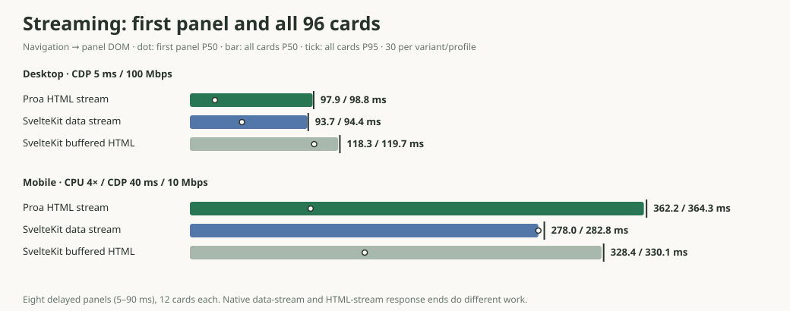

# Proa versus SvelteKit

Generated from fresh captures on **Apple M4 Max**, 2026-10-21 UTC. Proa revision **7ffb8a19**, **SvelteKit 3.1.0 / Svelte 5.57.2 / adapter-node 6.0.0**, Node **v24.20.0**. Full production builds, no development server, proxy, response cache, or compression.

The static 96-card HTML page sustained **17,838 responses/s for Proa** and **1,458 for SvelteKit**. In the native streaming browser tests, all 96 cards reached the DOM at median **97.9 ms / 93.7 ms on desktop** and **362.2 ms / 278.0 ms on mobile4x** (Proa / SvelteKit). Proa’s first mobile panel arrived at **96.4 ms**, versus **278.0 ms** for SvelteKit. The complete tables below retain first-panel timing, transfer size, CPU, overload failures, and every rate in the sweep.

## What the async comparison measures

SvelteKit's native [streaming with promises](https://svelte.dev/docs/kit/load#Streaming-with-promises) streams resolved **data**, then Svelte hydrates and renders the panels in the browser. An SSR [`{#await}` block](https://svelte.dev/docs/svelte/await) renders its pending branch on the server. Svelte's [async SSR documentation](https://svelte.dev/docs/svelte/await-expressions#Server-side-rendering) distinguishes blocking awaits from pending boundaries; it does not provide the equivalent of Proa's resolved-HTML boundary stream in this pinned release.

The comparison uses each framework's native streaming route:

| Framework | Server response contains | Browser work to show resolved panels |
| --- | --- | --- |
| Proa | Early fallback shell, then all 96 cards as resolved HTML inside boundary-replacement envelopes | Decode/insert resolved HTML using Proa's inline stream runtime |
| SvelteKit | Early fallback shell, then all eight promised panel values | Fetch the production client runtime, hydrate, and render 96 cards |

Every request uses the same eight delayed panels (5, 8, 12, 18, 27, 40, 60, and 90 ms), 12 cards per panel, five SVG stars per card, and prepared typed input values. SvelteKit's data serialization is part of its native path and is included. There is no external data service. The resolved panel DOM, including text, attributes, classes, element order, and all 480 stars, must match across all browser samples. The fixture preserves the existing benchmark's BackCompat document mode and utility-class markup; it is a rendering workload rather than a styled application. No CSS, product images, or fonts are fetched.

**HTTP response end is a different completion boundary for the data stream.** Its capacity numbers below describe delivering data, not delivering server-rendered product HTML. The browser table compares the same completed UI. This comparison has its own report rather than mixing the data-only response into the existing [HTML-streaming curve](http-capacity.md#suspense-streaming-over-http-one-core-each).

## Browser completion



Thirty measured fresh browser contexts per framework and profile across three Chromium launches, with order rotated. One untimed navigation per framework/profile warms each launch. Browser cache is disabled, service workers are blocked, and requests use identity encoding. Desktop: 1440×1000, 1× CPU, 5 ms latency, 100 Mbps. Mobile4x: 390×844, 2× DPR, 4× CPU slowdown, 40 ms latency, 10 Mbps down / 5 Mbps up. Chromium **149.0.7827.55**. These are simulated network/CPU profiles on the same desktop host, not measurements on a phone. [CDP latency](https://chromedevtools.github.io/devtools-protocol/tot/Network/#method-emulateNetworkConditions) is a minimum request-to-response-headers delay, rather than an extra RTT added on top of server processing.

Times start at navigation. “All cards” is the MutationObserver timestamp when every panel has 12 complete cards and 60 SVG stars; exact resolved DOM parity is checked afterward. “2 rAF” is the next two animation-frame callbacks after completion, an opportunity to paint, not a screenshot-based visual metric. Transfer includes document and client resources completed by that point, with headers. JS transfer counts external script resources; Proa's inline replacement scripts are included in its document bytes. Browser script/task durations are Chromium's reported ScriptDuration and TaskDuration, including the same observer instrumentation and excluding the later DOM parity traversal. They are CDP task timings rather than OS process CPU accounting.

| Profile | Framework | Shell P50 | First panel P50 | All cards P50 | All cards P95 | 2 rAF P50 | Total transfer | External JS | Script duration P50 | Task duration P50 |
| --- | --- | ---: | ---: | ---: | ---: | ---: | ---: | ---: | ---: | ---: |
| desktop | Proa | 9.65 ms | 20.0 ms | 97.9 ms | 98.8 ms | 120.6 ms | 378.7 KiB | 0.0 KiB | 4.66 ms | 24.8 ms |
| desktop | SvelteKit | 10.3 ms | 41.5 ms | 93.7 ms | 94.4 ms | 113.5 ms | 119.7 KiB | 101.4 KiB | 3.08 ms | 30.4 ms |
| mobile4x | Proa | 57.9 ms | 96.4 ms | 362.2 ms | 364.3 ms | 382.3 ms | 378.7 KiB | 0.0 KiB | 18.1 ms | 95.9 ms |
| mobile4x | SvelteKit | 61.7 ms | 278.0 ms | 278.0 ms | 282.8 ms | 293.2 ms | 119.7 KiB | 101.4 KiB | 11.4 ms | 112.1 ms |

JavaScript-disabled controls passed in both profiles: both frameworks leave the pending shell (zero rendered product cards). Proa's resolved HTML is transported inertly and needs its replacement script; HTML streaming here does not imply JavaScript-free progressive reveal.

## HTTP streaming capacity and latency

Three fresh processes per framework/rate, order rotated, one Proa Tokio worker or one Node process. Exact server CPU charges every process thread, including GC helpers. Twelve separate generator processes, 24 untimed warmup requests, one-second pre-roll, five-second observation window. Each generator uses a keep-alive agent capped at 256 sockets (3,072 total); any agent queueing is included in scheduled-arrival latency. The shared driver uses a 15-second socket timeout alongside platform TCP connection timeouts. Throughput counts successful responses ending inside that window; scheduled-arrival latencies include queueing and generator lag. Latency percentiles cover successful responses only; failures are reported separately and must be considered alongside them. At overload, failures censor the latency distribution, so a lower successful-response percentile can accompany more failed requests. Rows show medians of the three phase metrics, and errors are summed. High-load overload/errors are retained rather than treated as completed work. Every response is validated: Proa's complete HTML boundary payload or all SvelteKit promised values and product fields. The generator must stay below 80% worker utilization and 25 ms P95 scheduling lag; otherwise the capture aborts.

| Framework | Offered rps | Response ends/s | First byte P50 | Response end P50 | Response end P95 | Server CPU/response | Cores | Peak RSS | Document body | Errors |
| --- | ---: | ---: | ---: | ---: | ---: | ---: | ---: | ---: | ---: | ---: |
| Proa | 250 | 250 | 0.23 ms | 90.8 ms | 91.0 ms | 0.320 ms | 0.08 | 7.7 MiB | 378.4 KiB | 0 |
| SvelteKit | 250 | 250 | 0.42 ms | 90.8 ms | 91.0 ms | 0.803 ms | 0.20 | 200.0 MiB | 17.8 KiB | 0 |
| Proa | 500 | 500 | 0.19 ms | 91.4 ms | 91.6 ms | 0.267 ms | 0.13 | 8.7 MiB | 378.4 KiB | 0 |
| SvelteKit | 500 | 500 | 0.29 ms | 90.2 ms | 90.5 ms | 0.567 ms | 0.28 | 233.1 MiB | 17.8 KiB | 0 |
| Proa | 1,000 | 1,000 | 0.23 ms | 91.3 ms | 91.4 ms | 0.242 ms | 0.24 | 11.5 MiB | 378.4 KiB | 0 |
| SvelteKit | 1,000 | 1,000 | 0.34 ms | 90.4 ms | 90.7 ms | 0.568 ms | 0.56 | 261.0 MiB | 17.8 KiB | 0 |
| Proa | 2,000 | 2,000 | 0.17 ms | 91.2 ms | 91.3 ms | 0.223 ms | 0.44 | 17.4 MiB | 378.4 KiB | 0 |
| SvelteKit | 2,000 | 2,000 | 0.48 ms | 90.3 ms | 91.9 ms | 0.463 ms | 0.91 | 310.7 MiB | 17.8 KiB | 0 |
| Proa | 3,000 | 3,000 | 0.16 ms | 90.9 ms | 91.8 ms | 0.207 ms | 0.61 | 24.4 MiB | 378.4 KiB | 0 |
| SvelteKit | 3,000 | 3,003 | 0.98 ms | 91.6 ms | 95.5 ms | 0.413 ms | 1.22 | 359.3 MiB | 17.8 KiB | 0 |
| Proa | 4,000 | 4,000 | 0.28 ms | 91.0 ms | 92.2 ms | 0.205 ms | 0.81 | 30.3 MiB | 378.4 KiB | 0 |
| SvelteKit | 4,000 | 2,935 | 601.0 ms | 720.2 ms | 5942.0 ms | 0.416 ms | 1.02 | 527.3 MiB | 17.8 KiB | 1,186 |
| Proa | 5,000 | 4,994 | 5.61 ms | 102.5 ms | 135.6 ms | 0.194 ms | 0.95 | 46.1 MiB | 378.4 KiB | 0 |
| SvelteKit | 5,000 | 2,923 | 1738.0 ms | 1868.6 ms | 3474.8 ms | 0.405 ms | 1.10 | 555.3 MiB | 17.8 KiB | 1,072 |
| Proa | 6,000 | 4,600 | 621.9 ms | 1081.0 ms | 1817.1 ms | 0.186 ms | 0.88 | 222.6 MiB | 378.4 KiB | 0 |
| SvelteKit | 6,000 | 2,986 | 2443.2 ms | 2559.7 ms | 5937.2 ms | 0.394 ms | 1.06 | 537.2 MiB | 17.8 KiB | 0 |

Recorded failure messages across the full phases: SvelteKit: `connect ETIMEDOUT 127.0.0.1:<port>`. Overload includes the production server’s accept queue and HTTP adapter; connection retries/timeouts and server queueing are part of these scheduled-arrival results. This sweep is not a renderer-only microbenchmark.

## Static pages over HTTP

These are complete server-rendered pages on both sides. SvelteKit uses the production [Node adapter](https://svelte.dev/docs/kit/adapter-node), ordinary filesystem routing, and `csr=false`, avoiding an unnecessary hydration payload for the static-page workload. Every served response must hash to its engine's production dump; SvelteKit's full document also passes the canonical Svelte DOM gate and a changed-text negative control. Capacity uses 64 closed-loop connections, five-second windows, three fresh-process repeats. Equal-load latency uses the existing fixed rates below each engine's capacity, with three repeats. The [full five-engine capture](http-capacity.md#canonical-pages-over-http-one-core-each) also refreshes React, Marko, and Go.

| Workload | Engine | Capacity responses/s | CPU/response | Peak RSS | Equal-load rps | P50 | P99 |
| --- | --- | ---: | ---: | ---: | ---: | ---: | ---: |
| Component page | Proa | 87,426 | 0.011 ms | 8.1 MiB | 2,000 | 0.11 ms | 0.17 ms |
| Component page | SvelteKit | 9,693 | 0.122 ms | 392.1 MiB | 2,000 | 0.27 ms | 0.70 ms |
| Product grid | Proa | 17,838 | 0.056 ms | 9.3 MiB | 500 | 0.23 ms | 0.58 ms |
| Product grid | SvelteKit | 1,458 | 0.851 ms | 547.0 MiB | 500 | 0.96 ms | 1.84 ms |
| 1,000-row table | Proa | 2,957 | 0.338 ms | 71.2 MiB | 50 | 0.69 ms | 1.84 ms |
| 1,000-row table | SvelteKit | 121 | 8.440 ms | 466.4 MiB | 50 | 7.53 ms | 8.51 ms |

## Cold start

Spawn to first complete, validated 96-card product response. Fifteen fresh production processes per engine after two untimed disk-cache warmups; order rotates. This includes module loading, input construction, and the first render, but excludes dependency installation and build time. Warm filesystem cache is intentional; this is not a cold disk or deployed serverless platform measurement. The host one-minute load average at capture start was 19.62 on 16 logical CPUs; other work was active on this shared development machine.

| Engine | First response P50 | P95 | RSS after response |
| --- | ---: | ---: | ---: |
| Proa | 3.99 ms | 5.79 ms | 4.5 MiB |
| SvelteKit | 55.0 ms | 57.1 ms | 72.0 MiB |

## Renderer-only and product scaling

The existing Svelte row uses the **same pinned Svelte compiler** as the SvelteKit app. It measures compiled component rendering through `svelte/server`, while the HTTP rows above include the SvelteKit application server. Naming a second renderer-only row “SvelteKit” would measure the same renderer twice. All 17 renderers were rerun with five independent processes per cell; [full scoreboard](scoreboard.md).

| Workload | Proa P50 | Svelte P50 | Svelte ÷ Proa |
| --- | ---: | ---: | ---: |
| cards | 2.000 µs | 8.209 µs | 4.10× |
| products | 26.292 µs | 70.438 µs | 2.68× |
| table | 254.667 µs | 945.333 µs | 3.71× |

The scaling capture also reruns all 17 renderers at each size, five independent processes per cell. This is a separate renderer-only run, not cached output or a second HTTP measurement.

| Cards | Proa P50 | Svelte P50 |
| --- | ---: | ---: |
| 12 | 3.208 µs | 9.292 µs |
| 96 | 26.417 µs | 71.042 µs |
| 768 | 214.854 µs | 563.542 µs |

## Reproduce and inspect

`npm ci --prefix rendering/external/sveltekit` installs the pinned Kit/adapter/compiler toolchain. Follow the [repository setup](README.md#reproducing-a-capture) for the other languages and Playwright. Run timed suites sequentially on an idle host:

```sh
./rendering/run-all
./rendering/run-all --product-scaling --no-setup
node page-load/run.mjs
node cold-start/run.mjs
node sveltekit/run.mjs
node sveltekit/report.mjs
pnpm run refresh
node --test rendering/external/sveltekit/stream-validator.test.mjs
node sveltekit/report.mjs --check
```

Implementation: [production SvelteKit app](rendering/external/sveltekit/), [load runner](sveltekit/run.mjs), [browser observer](sveltekit/browser.mjs), and [promise-value validator](rendering/external/sveltekit/stream-validator.mjs).

Raw evidence: [streaming + browser samples](sveltekit/results/latest.json), [HTTP](page-load/results/latest.json), [cold starts](cold-start/results/latest.json), [renderer-only](rendering/results/latest.json), [scaling](rendering/results/product-scaling.json). Each capture retains timestamps, framework/host metadata and a measured-source SHA-256. The comparison generator refuses incomplete, smoke, stale-source, missing-phase, unsupported-throughput, browser-parity, and inconsistent-summary captures.

The retained capture also includes a buffered control for validation; it is excluded from the comparison charts and tables.

The Proa-only writer/memcpy and allocation microbenchmarks, linked showcase corpus, agent chain, and travel-agent studies do not contain equivalent SvelteKit applications. They remain explicitly separate; this change adds no invented SvelteKit rows to those studies. The development host is shared and uses no CPU affinity or exclusive-host isolation. Other desktop work can affect CPU clocks, medians, and tails; engine order rotates and every repeat remains available in the raw captures. These one-host results describe these fixtures and pinned versions, not a universal framework ranking.
